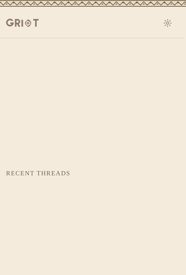
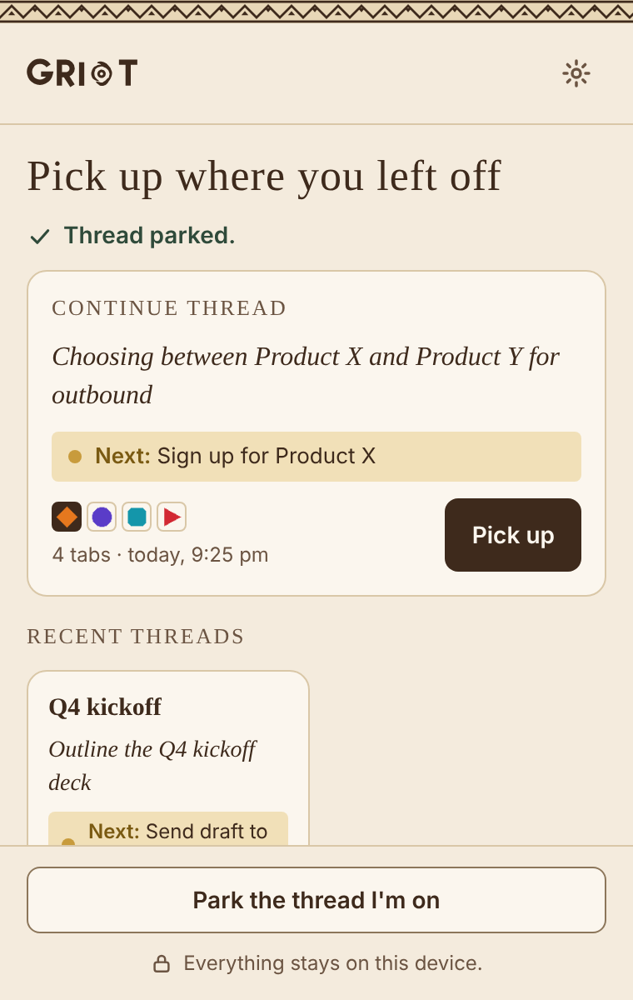
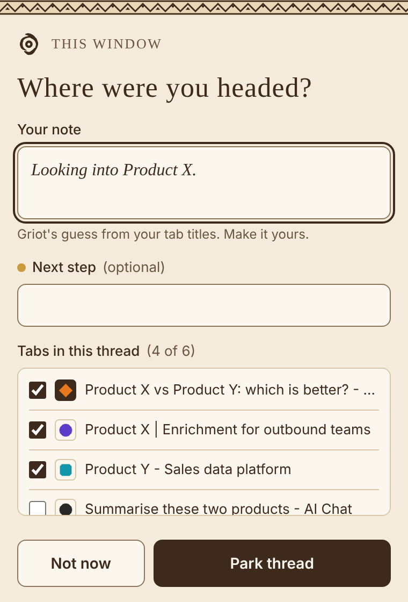
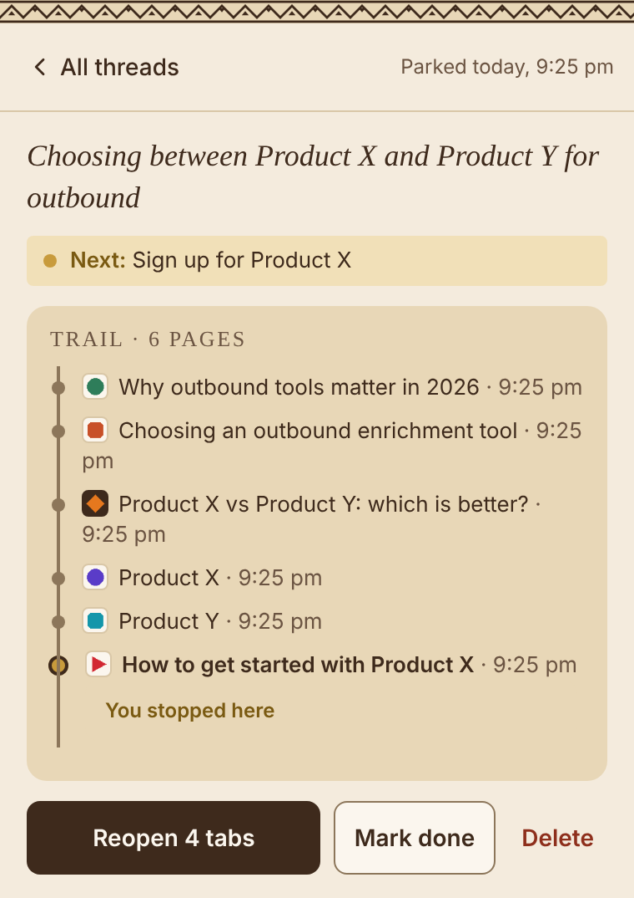
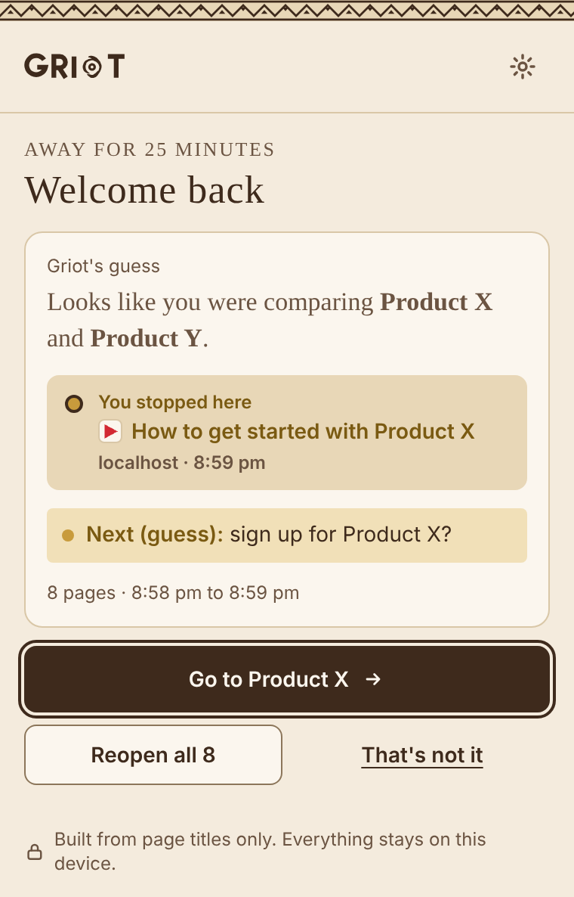
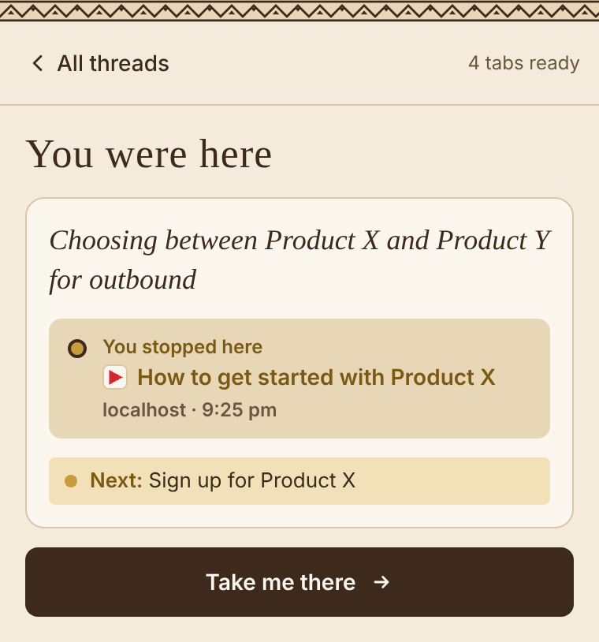
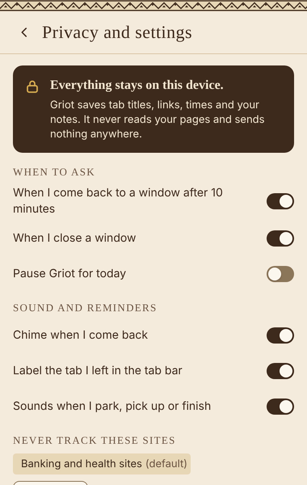

# Griot

**Your context lives on.**

Griot is a Chrome extension for the moment you come back to a window full of tabs and can't remember what you were doing. It quietly keeps the trail of pages you visit in each window. Come back after a break and it shows the page you stopped on, a guess at what you were doing, and takes you back in one click. If you want it to remember why, park the thread with one line in your own words before you leave.

Everything stays on your computer. Griot reads tab titles and links, never what's on the page.

<p align="center">
  
</p>

## What it does

**Park a thread.** Press "Park the thread I'm on" (or Option+Shift+P on a Mac, Alt+Shift+P on Windows). Griot drafts a note from your tab titles, labelled as its guess, and you can keep it or write your own. Tick the tabs that belong to the task and leave out the rest.

**Pick it up later.** Your parked threads wait on Griot's home screen, newest first. Pick up shows "You were here" with your note, the page you stopped on and your next step, while your tabs come back in the same window. Take me there jumps to the exact tab.

**Welcome back, even if you parked nothing.** Griot quietly keeps a trail of the pages you visit in each window. If you leave a window for 10 minutes or more and come back, it plays a soft chime, shows how long you were away on its icon (like "25m") and puts a small "You were here" label on the tab you left. Open Griot and the welcome back card shows where you stopped, with a guess at what you were doing and what comes next.

**Close a window by accident?** If it had three or more tabs, Griot offers to park it so nothing is lost.

## Screenshots

| Home | Park a thread | Thread and trail |
| :---: | :---: | :---: |
|  |  |  |
| **Welcome back** | **You were here** | **Privacy and settings** |
|  |  |  |

The sites in these screenshots are made up for the demo.

## Install

Griot isn't in a store yet, so you load it yourself. It takes about two minutes. It's built for Chrome and should also load in other Chromium browsers like Edge and Brave.

1. Download `griot-0.7.0.zip` from the [latest release](../../releases/latest) and unzip it. You'll get a folder called `griot`.
2. Open `chrome://extensions` (or `edge://extensions` in Edge).
3. Turn on **Developer mode** in the top corner.
4. Click **Load unpacked** and choose the `griot` folder.
5. Pin Griot from the puzzle-piece menu so its icon is always in your toolbar.

To update later, replace the files in the same folder and click the reload arrow on Griot's card. Use the same folder each time: loading it from a new folder gives Griot a new identity and your saved threads won't show up.

## Privacy

Griot was designed so there is nothing to leak.

- **Stored on your device only**, in Chrome's local extension storage. No account, no server, no analytics, no network requests of any kind.
- **What it saves:** tab titles, web addresses, the times you visited them, and the notes you write.
- **What it never touches:** what's on a page, anything you type into a website, passwords, cookies or screenshots. It has no permission to read web pages at all.
- **Never tracked:** banking and health sites are skipped by default, and you can add your own sites in settings. Adding a site also removes its pages from your trails.
- **You're in control:** pause Griot for the day, switch each reminder on or off, or delete every thread and trail in one go.
- **Trails are short-lived:** they're cleared every time Chrome restarts.

## Permissions

| Permission | Why Griot needs it |
| --- | --- |
| `tabs` | To read the titles and addresses of your open tabs, and to reopen them when you pick up a thread. |
| `storage` | To save your threads, trails and settings on your computer. |
| `favicon` | To show each site's icon from Chrome's own saved copy, without contacting the site. |
| `idle` | To notice when you've stepped away from your computer while a window was in front. |
| `tabGroups` | To put the small "You were here" label on the tab you left. |
| `offscreen` | To play the welcome back chime. A hidden page opens for a second, plays the sound and closes. It can't see your tabs. |

There are no host permissions and no content scripts, so Griot can't run on or read any website.

## How the guesses work

There's no AI and nothing leaves your computer. Griot uses a few plain rules on page titles:

- A word or name that repeats across your tabs is probably the topic ("Looking into Product X").
- A "this vs that" page followed by both products' own sites means you were comparing them.
- A tutorial or "how to" page for one of them after that suggests signing up for it next.

Anything Griot guesses is labelled "Griot's guess", and your own words always come first. If a guess is wrong, "That's not it" lets you write the note yourself.

## Built with

Plain HTML, CSS and JavaScript on Chrome's Manifest V3. No frameworks, no build step and no npm packages, so the folder you download is the extension. Sounds are made by the browser's audio engine, so there are no audio files either.

```
manifest.json        the extension's settings and permissions
background.js        records the trail, notices when you leave and come back
popup/               the screens you see when you click the icon
lib/                 storage, the guessing rules and the sounds
offscreen/           the hidden page that plays the chime
docs/                screenshots for this page
```

Product decisions and the reasons behind them are logged in [DECISIONS.md](DECISIONS.md).

## About

Griot is an open-source portfolio project by Anshuraj Baruah. I built it to explore one question: what's the smallest thing a browser could remember that would let you pick up a task in under a minute? I designed it and made the product calls, and built it with Claude Code.

A griot is a West African storyteller and keeper of history. This one keeps the story of your tabs.

## License

[MIT](LICENSE)
